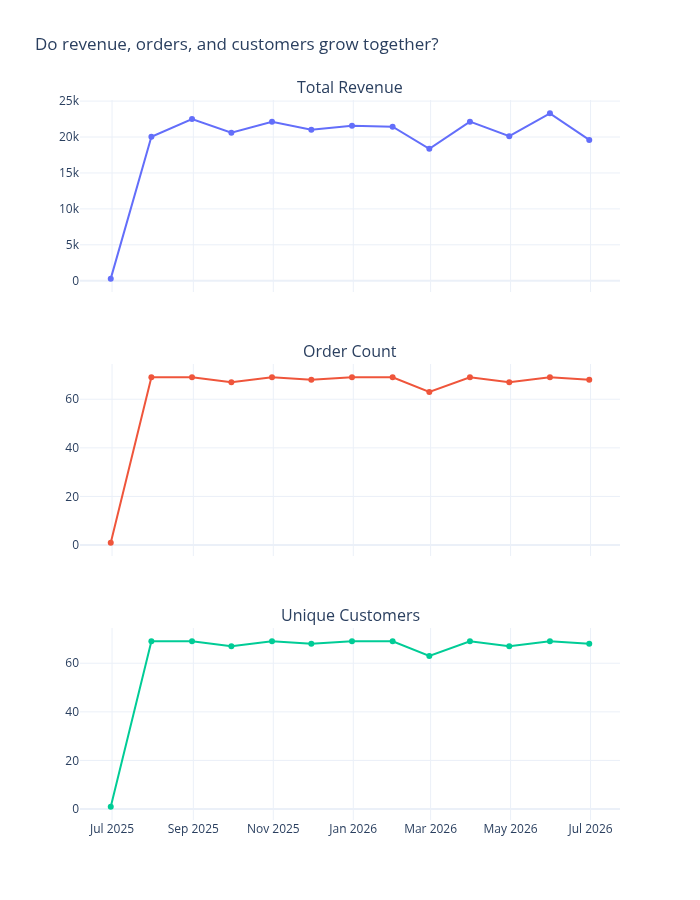

# Ecom Insights

A deterministic e-commerce analytics pipeline that turns raw order data into a loaded star-schema warehouse, 18 analysis CSVs, 7 charts, a number-grounded executive briefing, a formatted Excel workbook, and a PowerPoint management presentation.



(There is no single "dashboard" image file — `create_dashboard()` regenerates the individual chart files above with business-question titles. This one is the closest to an overview, showing revenue, order count, and unique customers on the same trend.)

## The business questions this analysis answers

Each chart in `reports/` is titled with the question it answers:

- Is revenue trending up or down over time? (`sales_trend_total_revenue.png`)
- How does order volume trend over time? (`sales_trend_order_count.png`)
- Do revenue, orders, and customers grow together? (`sales_metrics_comparison.png`)
- Which products drive the most revenue? (`top_products_total_revenue.png`)
- Which categories generate the most revenue? (`category_performance_total_revenue.png`)
- Which customer segments are the most valuable? (`customer_segments.png`)
- How well does the business retain customers by signup cohort? (`cohort_retention.png`)

## Quickstart

```bash
git clone https://github.com/MaheshBhushan/ecom-insights.git
cd ecom-insights
python -m venv venv
source venv/bin/activate          # Windows: venv\Scripts\activate
pip install -r requirements.txt

cp .env.example .env              # defaults already point at the compose Postgres below
docker compose up -d              # starts Postgres on host port 5433

python -m src.main --source sample --load
```

This runs the full pipeline (extract, transform, analyze, visualize) against the bundled sample data, writes 18 CSVs to `data/processed/` and 7 PNGs to `reports/`, then loads the star schema into Postgres. Exits 0 on success.

To reload the warehouse from already-transformed CSVs without re-running the rest of the pipeline:

```bash
python -m src.main --load-only
```

The KPI file is computed in code from the warehouse and needs no API key:

```bash
python -m src.insights.kpis        # computes reports/kpis.json from the warehouse
```

Only the briefing itself calls a model, and only that step needs `ANTHROPIC_API_KEY` in `.env`:

```bash
python -m src.insights.briefing    # sends only kpis.json to claude-sonnet-5, writes reports/executive_briefing.md
```

Everything else in this project runs without an API key.

Generate the management-ready Office outputs from the committed, validated
pipeline artifacts:

```bash
python -m src.reporting.office_reports
# or
python -m src.main --office-report
```

This writes:

- `reports/ecom_insights_analysis.xlsx` — a seven-sheet analysis workbook with
  KPI summaries, formatted tables, native Excel charts, conditional formatting,
  metric definitions, and source lineage.
- `reports/ecom_insights_management_briefing.pptx` — a seven-slide management
  briefing with KPI callouts, native PowerPoint charts, recommendations, and
  source notes.

Neither command requires Microsoft Excel or PowerPoint. The report generator
uses `openpyxl` and `python-pptx` directly and does not call an LLM. When the
validated `executive_briefing.json` is available, its grounded narrative is
used; otherwise the deck and workbook use a deterministic fallback narrative.

## Architecture

```
data/raw/*.csv
      |
      v
[ extract ]   src/extraction/data_extractor.py
      |
      v
[ transform ] src/transformation/data_transformer.py
      |
      v
[ analyze ]   src/analysis/data_analyzer.py --> data/processed/*.csv (18 files)
      |
      v
[ visualize ] src/visualization/data_visualizer.py --> reports/*.png (7 files)
      |
      v
[ load ]      src/load/warehouse_loader.py --> Postgres star schema (--load / --load-only)
      |
      v
[ insights ]  src/insights/kpis.py --> reports/kpis.json
              src/insights/briefing.py --> reports/executive_briefing.md (needs ANTHROPIC_API_KEY)
      |
      v
[ reporting ] src/reporting/office_reports.py --> reports/ecom_insights_analysis.xlsx
                                               --> reports/ecom_insights_management_briefing.pptx
```

`python -m src.main --source sample --load` runs extract through load in one process. `--load-only` skips straight to the load step using the CSVs already in `data/processed/`. The insights step is separate and reads only the warehouse output, not the pipeline internals.

## Data model

`sql/star_schema.postgres.sql` defines the warehouse actually loaded by `src/load/warehouse_loader.py`:

- `dim_customer` — one row per customer
- `dim_product` — one row per product
- `dim_date` — one row per calendar date present in the data
- `fact_sales` — one row per order line item (`order_id`, `product_id`), FK'd to all three dimensions, with `gross_revenue`, `net_revenue`, `discount_amount`, and `cost` per line

A star schema was chosen because the analysis questions above are all "sum/average a measure, grouped by a dimension" (revenue by category, orders by month, retention by signup cohort) — the fact table carries the measures at line-item grain and the dimensions carry the group-by columns, so every question above is a single join and aggregate against `fact_sales`.

`src/load/warehouse_loader.py` validates the CSVs before writing anything (missing columns, null keys, duplicate `(order_id, product_id)` grain, negative quantity or price, orphan foreign keys all cause a non-zero exit) and then truncates and reloads all four tables in FK order inside one transaction, so re-running `--load` does not double rows.

`sql/star_schema.azuresql.sql` is the T-SQL equivalent of the same schema, committed as a documented cloud target. **It has never been executed against a live database** — the project's Azure subscription is disabled.

## KPI definitions

All figures in `reports/kpis.json` and `reports/executive_briefing.md` use one definition, applied consistently across the analysis, warehouse, and charts:

- **Revenue (`gross_revenue`)** is the pre-discount line total (`quantity x unit_price`), summed over line items, **excluding orders with status `Cancelled`**. Shipping and tax are never included.
- **`net_revenue`** is `gross_revenue` minus `discount_amount` for the same excluded-Cancelled line items.
- Cancelled orders are 272 of 1089 (24.98%) in the sample data and are excluded from every revenue, margin, and AOV figure, not just `kpis.json`.

This project previously reported three different revenue totals for the same dataset (see the "Use one revenue definition across every layer" commit) because different layers summed different columns (`order_total`, which includes shipping and tax, vs. line totals) and disagreed on whether to exclude Cancelled orders. There is now exactly one definition, used by `src/analysis/data_analyzer.py`, `src/load/warehouse_loader.py`, and `src/insights/kpis.py` alike.

## Findings

Numbers below are from `reports/kpis.json`, generated by `python -m src.insights.kpis` against the loaded warehouse.

1. **A quarter of demand never converts to revenue.** 272 of 1089 orders (24.98%) are Cancelled and are excluded from the $253,080.00 gross revenue total — see `cancelled_order_count`, `cancelled_order_share_pct`, `gross_revenue_total` in `reports/kpis.json`.
2. **Discounting removes $19,135.25 from gross revenue**, taking $253,080.00 gross down to $233,944.75 net (`total_discount_amount`, `gross_revenue_total`, `net_revenue_total`), a gap large enough to change which category looks strongest.
3. **Sports is the strongest category and Electronics the weakest**, at $64,898.75 vs. $28,220.50 net revenue (`top_category`, `weakest_category` in `reports/kpis.json`, backed by `reports/category_performance_total_revenue.png` and `data/processed/category_performance.csv`).

## GenAI grounding

`src/insights/kpis.py` computes every figure in `reports/kpis.json` directly from the warehouse in plain code — no model is involved in producing the numbers. `src/insights/briefing.py` then sends **only** that JSON file to `claude-sonnet-5` and validates the response before writing `reports/executive_briefing.md`: it rejects invalid JSON, missing or unexpected keys, a recommendation with no evidence citation, a citation to a field that doesn't exist in `kpis.json`, and any numeric literal in the prose that isn't traceable back to a value in `kpis.json` (matching allows formatting differences — rounding, `%`, `$`, thousands separators — within a fixed tolerance of 0.01, not a percentage of the value). A rejection exits non-zero; the script does not retry or fall back to writing an ungrounded briefing.

**Known limitation**: numbers spelled out as words ("twelve hundred") are not detected by the grounding check, only digit-based numeric literals. `tests/test_grounding.py` has 13 tests covering the rejection paths (fabricated figures, unknown-field citations, near-misses on real values, date components that shouldn't be usable as standalone numbers).

The briefing also demonstrates the check working as intended on real output: it flags the sample data's 100% repeat-customer rate (`repeat_customer_rate_pct`) as an artifact of the synthetic dataset rather than treating it as a genuine finding — see "Limitations" below.

## Limitations

- **The data is synthetic.** `src/main.py::create_dummy_data()` generates it deterministically from `config.DATA_ANCHOR_DATE`; it is not real transaction data.
- **The 100% repeat-customer rate (`repeat_customer_rate_pct` in `reports/kpis.json`) is an artifact of that synthetic data**, not a real retention signal — the generator assigns customers to orders in a way that guarantees repeats across only 100 customers. The briefing itself calls this out as a data-quality issue rather than a finding to act on.
- **The Azure SQL schema (`sql/star_schema.azuresql.sql`) has never been executed.** It documents the intended cloud target only; the project's Azure subscription is disabled.
- **There is no BI tool.** No Power BI, no Tableau, no notebook, no scheduled report — only the committed PNGs in `reports/` and the CSVs in `data/processed/`.
- **Office reporting is generated, not interactive BI.** The Excel workbook and PowerPoint deck are portable management deliverables, not live dashboards.
- **Single-node, no orchestration.** The pipeline is one Python process run manually; there is no Airflow, cron, or equivalent scheduler.
